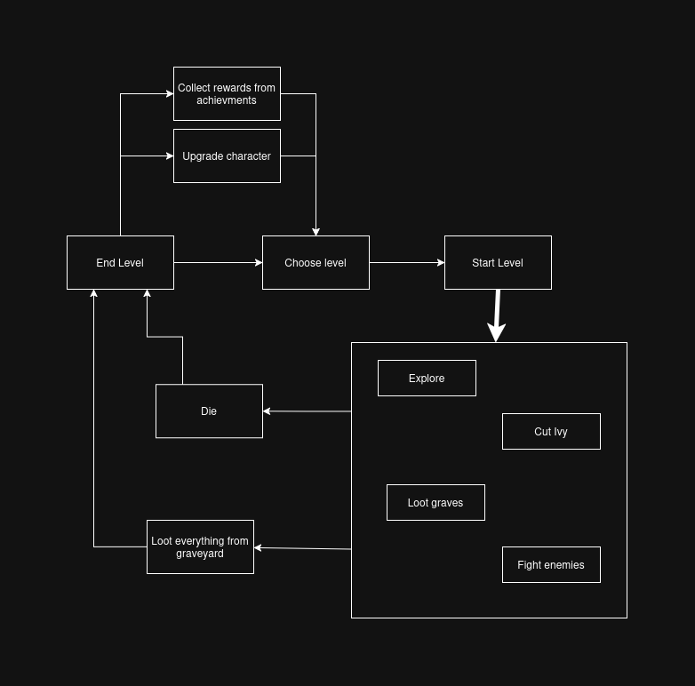
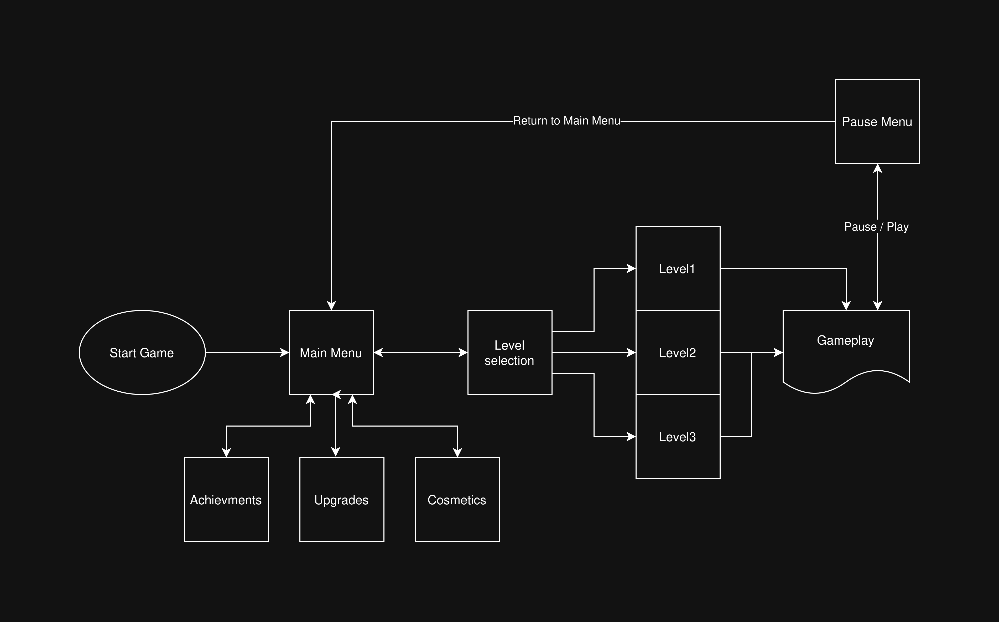
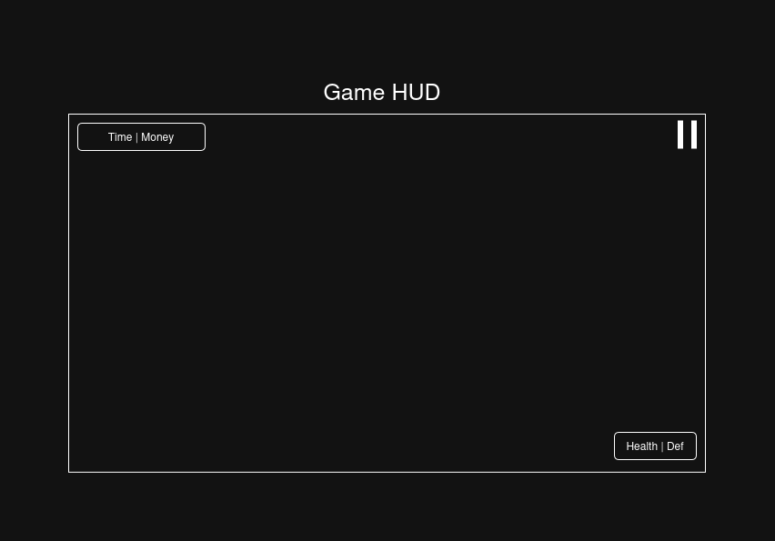

## Krátky popis 
Hlavná postava - Grave stalker sa vydáva na hmlistý brečtanom zarastený cintorín. Snaží sa v hroboch a hrobkách nájsť poklady pre svoje obohatenie. Avšak vnútri ho čakajú nemilé prekvapenia. Cieľom hry je nazbierať čo najviac peňazí v danom leveli - cintoríne. Hráč ovláda vykrádača hrobov, ktory prekutráva cintorín, presekáva sa brečtanovím porastom. Otvára hroby a dúfa že v nich nájde poklady. V hroboch však môžu číhať iný obyvatelia cintorína - kostlivci, smrtonoši, pavúci a horšie veci. Ak príde smrť hráč sa vydáva na cintorín odznova.  

## Inšpirácia 
Gameplay loop a vizuáli sú inšpirované survival hororom darkwood a inými rogue like hrami. A samozrejme zberom brečtanu na starom židovskom cintoríne 

## Základné info 

|||
|-----|-----------------------------|
|Žáner|Rouge-like, RPG, Singleplayer|
|Platforma|Windows, Linux|
|Kamera|2D isometrická|
|Art-Style|Pixel|

## Postavy 

### Grave Stalker

|||
|------|-----|
|Životy||
|Obrana||
|ǔtok||
|Rýchlosť||
|Rýchlosť útokov||

### Grave Dweleri

#### Enemy template

|||
|------|-----|
|Životy||
|Obrana||
|ǔtok||
|Rýchlosť||
|Rýchlosť útokov||

## Ovládanie 

|Klávesa|Funkcia|
|-------|-------|
|A| Pohyb doľava |
|W| Pohyb hore |
|S| Pohyb dole |
|D| Pohyb vpravo |
|Space| útok a ničenie prostredia |
|E| interakcia s prostredím|
|Esc| pauza |

## Mechaniky 

### Core

#### Pohyb

#### Boj
S nepriateľmi vie avatar bojovať. Existujú tu len základné útoky, ktorých sila je určená silov útokov. Rýchlosť útokov sa tiež mení s vylepšovaním rýchlosti útokov. Nepriatelia útočia naspäť. Pokiaľ má hráč dostatočnú rýchlosť vie "kitovať" nepriateľov. 
 
#### Interakcia s objektami 
S hrobmi, truhlicami a prípadne pákami, fakľami ktoré by slúžili na odomykanie tajných časti mapy. 

#### Procedurálne generovanie prostredia
Celá mapa a jej obsah je procedurálne generovaný, t.j. pozícia všetkých hrobov, truhlíc, brečtanu, nebezpečných zón, hrobiek ale aj typu a množstva nepriateľov či peňazí. Generácia je obmedzená pravidlami pre množstvá a rozostupy ktoré sú zachytené v tejto tabuľke. 

#### Ničenie častí prostredia 
Niektoré prekážky cez ktoré hráč nevie prejsť, sú zničiteľné. Ide o vegetáciu - brečtan. Hráč si týmto spôsobom odblokovať ďaľšie častie mapy. 

### Meta

#### Damage zony

#### Skryté časti mapy

#### Achievmenty

#### Zlepšovanie schopnosti

|Vlastnosť|Základná hodnota|Zlepsenie o|Cena za level|
|---------|----------------|-----------|-------------|
|Maximálne životy|         |           |             |
|Maximálna obrana|         |           |             |
|Sila útokov|              |           |             |
|Rýchlosť útokov|          |           |             |
|Rýchlosť avatara|         |           |             |

#### Zmena vzhľadu avataru

## Core Game Loop 

## Screens 

## UI 

## HUD

