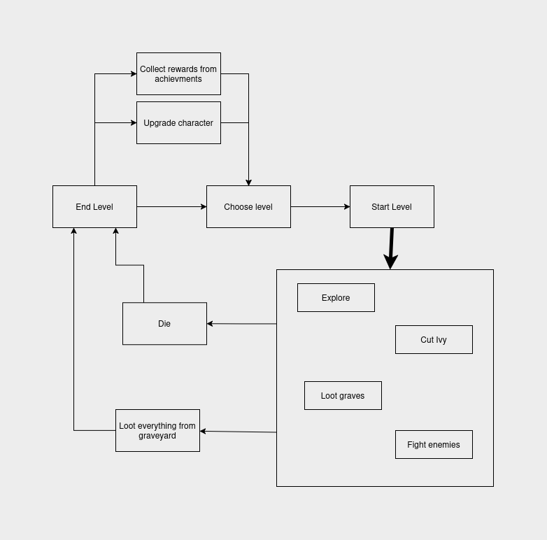
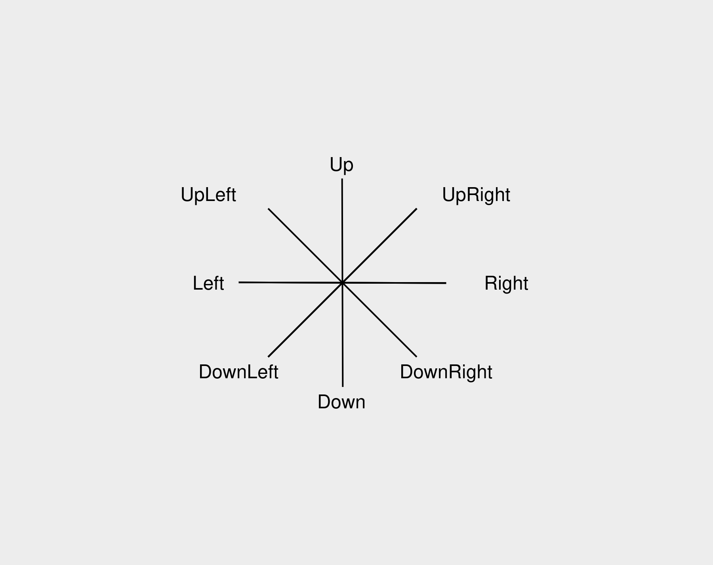
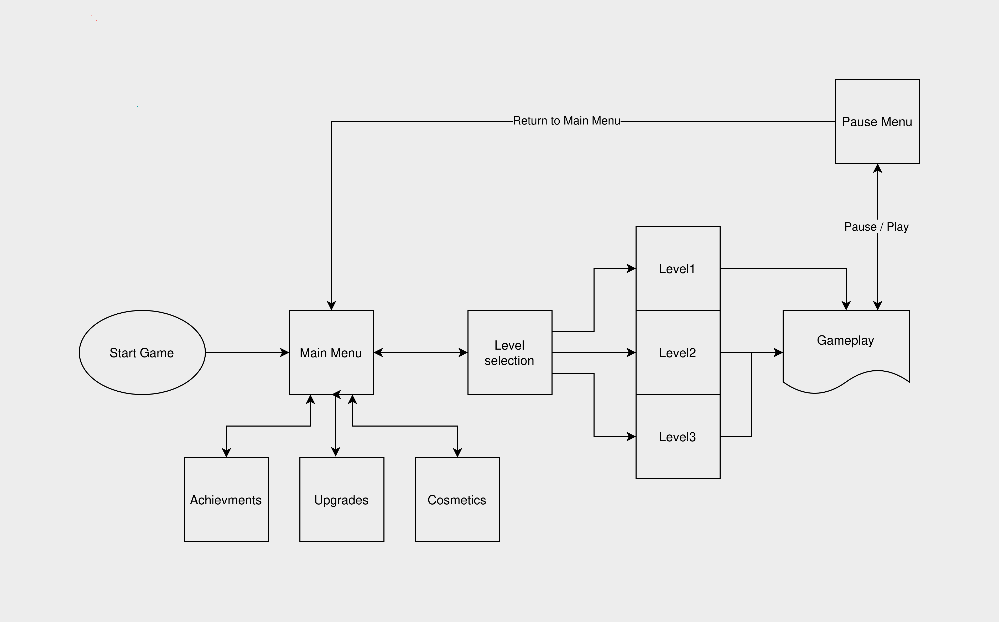
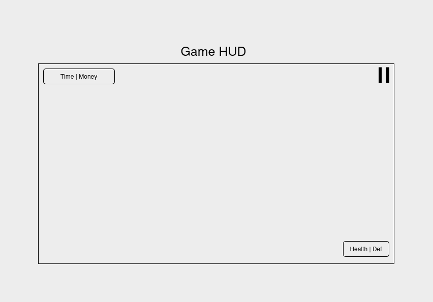

# Grave Stalker 

## Základné info 
|||
|-----|-----------------------------|
|Žáner|Rouge-like, RPG, Singleplayer|
|Platforma|Windows, Linux|
|Kamera|2D isometrická|
|Art-Style|Pixel|

## Krátky opis 
Hlavná postava - Grave stalker sa vydáva na hmlistý brečtanom zarastený cintorín. Snaží sa v hroboch a hrobkách nájsť poklady pre svoje obohatenie. Avšak vnútri ho čakajú nemilé prekvapenia. Cieľom hry je nazbierať čo najviac peňazí v danom leveli - cintoríne. Hráč ovláda vykrádača hrobov, ktory prekutráva cintorín, presekáva sa brečtanovím porastom. Otvára hroby a dúfa že v nich nájde poklady. V hroboch však môžu číhať iný obyvatelia cintorína - kostlivci, smrtonoši, pavúci a horšie veci. Ak príde smrť hráč sa vydáva na cintorín odznova.  
## Inšpirácia 
Gameplay loop a vizuáli sú inšpirované survival hororom Darkwood, Wampire Survivors a inými rogue like hrami. A samozrejme zberom brečtanu na starom židovskom cintoríne.

## Ovládanie 

|Klávesa|Funkcia|
|-------|-------|
|A| Pohyb doľava |
|W| Pohyb hore |
|S| Pohyb dole |
|D| Pohyb vpravo |
|Space| útok a ničenie prostredia |
|E| interakcia s prostredím|
|Esc| pauza |

## Postavy 

### Grave Stalker

Grave Stalker je hlavná postava hry. Je definovaný vlastňostami, ktoré si vie zlepšovať - pozri [zlepšovanie postavy](gdd_final.md#zlepšovanie-schopnosti). Pohybuje sa po mape, otvára hroby a bojuje s nepriateľmi 

|Vlastnosť|Popis|
|------|-----|
|Životy|Koľko útok vie avatar absorbovať, neregeneruje sa|
|Obrana|Rovnako ako životy, regeneruje sa po čase|
|Útok|Koľko životou / obrany uberie |
|Rýchlosť|Rýchlosť pohybu po mape|
|Rýchlosť útokov|Ako rýchlo avatar udiera|

### Grave Dweleri

Na mape sa vedia nachádzať aj nepriateľské stvorenia - Grave Dweleri. Zvyčajne sa schovávajú v hroboch alebo secretoch ale môžu sa nachádzať aj voľne po mape. Majú rovnáké vlastnosti ako Grave Stalker.  Grave Dweleri sa začnú hýbať k avatarovi ak sa dostane do ich akčného rádiusu alebo ak vypadnú z hrobu. Pokiaľ hráč náhodou odíde z ich akčného rádiusu, stále sa budú hýbať s merom k nemu.  V základnej implementácii majú všetci Grave Dweleri rovnaký akčný rádius (táto vlastnosť sa bude meniť s balansovaním hry).
#### Kostlivec
Má slabú výdrž a silné útoky. 
#### Smrtonoš
Má malú rýchlosť, silnú výdrž a slabé útoky.
#### Pavúk 
Má veľkú rýchlosť, slabú výdrž a slabé útoky. 

## Mapa - cintorín

Mapa (cintorín) je procedurálne vygenerovaná a skladá sa z objektov: prekážka, kontajner, destructible a secret. 
- Prekážka - objekt cez ktorý nevie avatar prejsť. 
- Kontajner - objekt ako prekážka, ale nachádzajú sa tam peniaze alebo sa tam skrýva [Grave Dweller](gdd_final.md#grave-dweleri). Po interakcii avatara sa "otvorí" a to čo sa náchdza vnútri vypadne von
- Destructible - objekt ako prekážka, hráč ju vie útokom zničiť. 
- Secret - objekt ktorý zaberá časť mapy a dá sa do neho dostať len po vyriešení jednoduchého puzzle.
Prehľad jednotlivých objetkov a verzia v ktorej budú implementované:

| Objekt        | Funkcia      | Implementácia |
| ------------- | ------------ | ------------- |
| Krík          | Prekážka     | Základ        |
| Kameň         | Prekážka     | Základ        |
| Strom         | Prekažka     | Bonus         |
| Hrob          | Kontajner    | Základ        |
| Truhlica      | Kontajner    | Základ        |
| Suchý strom   | Kontajner    | Bonus         |
| Padnutý strom | Kontajner    | Bonus         |
| Brečtan       | Destructible | Základ        |
| Hrobka        | Secret       | Bonus         |
| Krypta        | Secret       | Bonus         |

Mapa je potiahnutá štvorcovou sieťou kde jeden štvorček služi ako základná jednotka vzdialenosti.
Hráč má možnosť si vybrať z rôznych máp. Odlišujú sa len iným vzhľadom nepriateľov, pozadia a objektami mapy.

## Core Game Loop 

Hráč si vždy zvolí level - "iný vzhľad mapy". Následne vstupuje na cintorín, kde otvára hrobi, bojuje s Grave Dwelermi, presekáva sa brečtanom. Level sa končí buď smrťou (peniaze mu hráčovi ostatnú) alebo vykradnutím (otvorením) všetkých hrobov na cintoríne. Je tu menšie oneskorenie, pred ukončením levelu, aby hráč stihol pozbierať všekty peniaze z posledného hrobu. Hráč potom pozbiera odmeny za achievmenty, prípadne ak má dosť peňazí zlepší niektorú z vlastností Grawe Stalkera. 
 

## Mechaniky 

### Core
Tieto mechaniky je v pláne implementovať v základnej verzii hry.
#### Pohyb
Avatar sa vie hýbať do ôsmych smerov. Nevie sa pohnúť na miesta kde sa nachádza iný objekt alebo Grave Dweler.

#### Boj
S nepriateľmi vie avatar bojovať. Existujú tu len základné útoky, ktorých sila je určená silov útokov. Rýchlosť útokov sa tiež mení s vylepšovaním rýchlosti útokov. Grave Dweleri útočia naspäť. Smer útoku je v smere posledného pohybu avatara. Dosah útoku je jeden štvorček (aj diagonálny) a útok nevie prechádzať cez objekty. Pokiaľ má hráč dostatočnú rýchlosť pohybu vie "kitovať" nepriateľov. 

Pri zásahu sa poškodenie najskôr odpočítava z aktuálnej obrany avatara. Ak je hodnota poškodenia vyššia ako aktuálna obrana, zostávajúce poškodenie sa odpočíta zo životov. Obrana sa po určitom čase od posledného zásahu začne postupne regenerovať až do svojej maximálnej hodnoty. Životy sa prirodzene neregenerujú.
#### Interakcia s objektami 
Avatar vie interagovať s hrobmi, truhlicami a prípadne pákami a fakľami ktoré by slúžili na odomykanie secretov. Po interakcii s truhlicou vypadnú na zem v okolí truhlice peniaze ktoré treba pozbierať pre ich zarátanie. Pri hrobe nastane to isté ale ak sa tam ukrýva Grave Dweler tak ten "vypadne" na políčko v okolí hrobu a okamžite začne útočiť na avatara. 

#### Procedurálne generovanie prostredia
Celá mapa a jej obsah je procedurálne generovaný, t.j. pozícia všetkých hrobov, truhlíc, brečtanu, hrobiek ale aj typu a množstva nepriateľov či peňazí. Generácia je obmedzená pravidlami t.j minimálne a maximálne množstvá, minimálny rozostup medzi objektami a podmienka, že mapa musí byť priechodná pre avatara t.j. vie sa dostať ku všetkým hrobom

#### Ničenie častí prostredia 
Destructible objetky vie avatar ničiť svojími útokmi. Vzťahuje sa tu rovnaká mechanika ako na boj, s jediným rozdielom, že objekt neútočí na avatara.

#### Zlepšovanie schopnosti

Všetky vlastnosti avatara sa dajú zlepšovať za peniaze ktoré boli získané na mape. Avatar má každú vlastnosť na leveli nula - na základnej hodnote. Hráč zaplatí za jeden level (cena za level sa postupne zvyšuje) a  zvolená vlastnosť sa zvýši o určenú hodnotu. 

Ilustračný príklad nastavenia hodnôt a súm za level:

| Vlastnosť        | Základná hodnota | Zlepsenie o | Cena za level |
| ---------------- | ---------------- | ----------- | ------------- |
| Maximálne životy | 10               | 1           | 5 (x0.25)     |
| Maximálna obrana | 2                | 1           | 5 (x0.25)     |
| Sila útokov      | 2                | 1           | 5 (x0.25)     |
| Rýchlosť útokov  | 1                | 0.1         | 5 (x0.25)     |
| Rýchlosť avatara | 1                | 0.1         | 5 (x0.25)     |
Čísla v zátvorkách je multiplikátor o ktorý by sa zvyšovala cena za level. 

### Optional
Tieto mechaniky naplánované na implementáciu ak zostane čas alebo počas vývoja nastane situácia že budú nevyhnutné pre gameplay loop.
#### Damage zony    
Niektoré časti mapy - pokryté jedovatými výparmi budú spôsobovať avatarovi periodické poškodenie pokiaľ sa tam bude nachádzať 
#### Skryté časti mapy - secreti
Na mape sa bude vždy nachádzať časť - Hrobka alebo Krypta. Do tejto časit sa vie hráč dostať len ak vyrieši jednoduchý puzzle. Napríklad pozaťahuje za správne páky, zapalí všetky fakle.
#### Achievmenty
Za splnené mílniky (Achievmenty), napríklad sto zničených brečtanov, vie hráč získať peniaze alebo skiny po tom čo odíde z levelu. 
#### Zmena vzhľadu avataru
Za peniaze alebo achievmenty vie hráč získať kosmetické úpravy pre avatara. Tieto "skiny" si vie hráč meniť v menu "Cosmetics".

## Logika menu 

## HUD 
